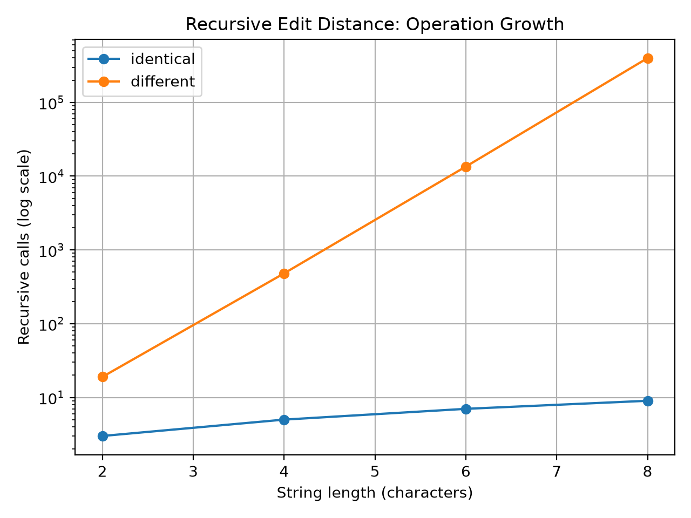
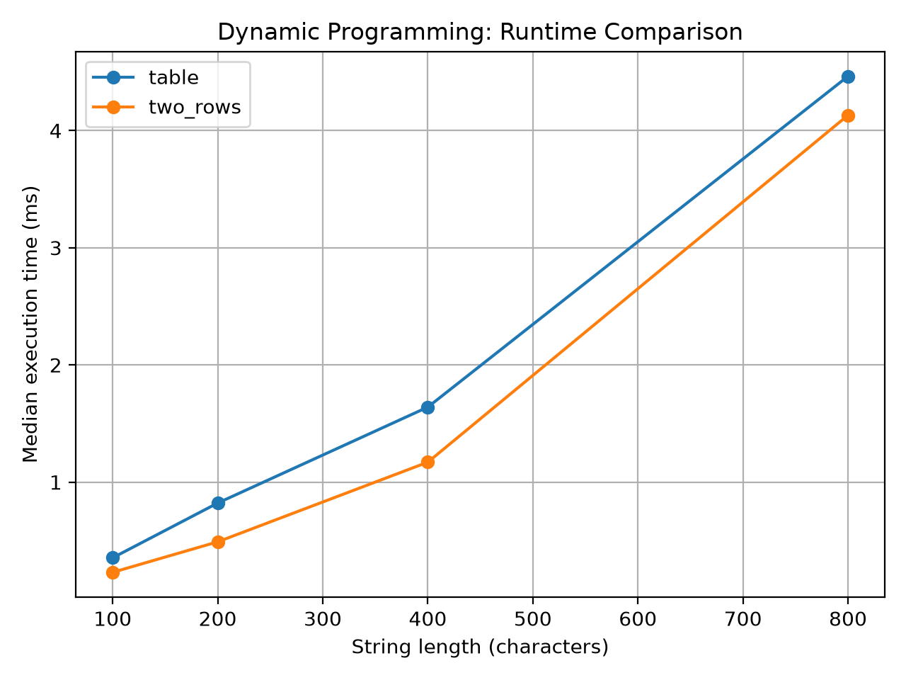
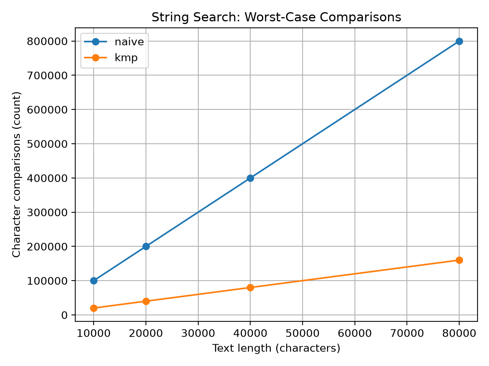

# Assignment 4 — Dynamic Programming and String Algorithms

## 1. Experiment Design Card

| Field | Edit Distance | String Search |
|---|---|---|
| Question | How does the computational cost change as the input strings become longer? | How do Naive Search and KMP behave on random and difficult inputs? |
| Sizes | Recursive: 2, 4, 6, 8. DP: 100, 200, 400, 800. | Text lengths: 10,000, 20,000, 40,000, 80,000. |
| Inputs | Identical strings and completely different strings. | Random strings and repeated-character text with a nearly matching pattern. |
| Metrics | Execution time in milliseconds and operation counts. | Execution time in milliseconds and character comparisons. |
| Prediction | Recursive Edit Distance will become expensive on different strings. Table and Two Rows will scale better. | Naive Search will perform more comparisons on difficult inputs, while KMP will avoid repeated comparisons. |
| Plots | Recursive operation growth and DP runtime comparison. | Worst-case character comparison chart. |

A fixed random seed of 42 was used to generate reproducible input data. Each experiment included three warm-up runs and five measured runs. Median execution time was used to reduce the influence of timing fluctuations.

The initial input sizes were increased after preliminary measurements showed very small execution times. The final sizes were selected to make the performance differences easier to observe.

## 2. Edit Distance Results

Three implementations of Edit Distance were compared: Recursive, Table and Two Rows.

### Recursive Edit Distance

**Observation:** The number of recursive calls increased rapidly for completely different strings, while identical strings required far fewer calls.

For strings of length 8, the recursive algorithm performed 398,593 calls on completely different strings, compared with only 9 calls on identical strings.

This happens because direct recursion repeatedly solves the same subproblems without storing previous results.

### Dynamic Programming Comparison

**Observation:** Both dynamic programming implementations showed increasing execution time as the string length increased.

For strings of length 800, the measured median execution times on different strings were approximately 4.46 ms for Table and 4.13 ms for Two Rows.

Both implementations have O(n × m) time complexity. However, Table requires O(n × m) extra space, while Two Rows uses O(m) extra space.

## 3. String Search Results

Two string-search algorithms were compared: Naive Search and Knuth-Morris-Pratt (KMP).

### Worst-Case Character Comparisons

**Observation:** Naive Search performed substantially more character comparisons than KMP on the repeated-character inputs.

For a text length of 80,000 characters and a pattern length of 10, Naive Search performed approximately 800,000 comparisons, while KMP performed approximately 160,000 comparisons.

Naive Search repeatedly compares characters at different starting positions. KMP uses the LPS array to avoid repeating comparisons after a mismatch.

Both comparison counts grew approximately linearly with text length in this experiment because the pattern length remained fixed.

## 4. Prediction vs. Results

### Edit Distance

I expected direct recursion to become much slower on difficult inputs because it does not reuse previously calculated results.

The results supported this prediction. Recursive calls increased rapidly as the input size grew. The dynamic programming versions handled larger strings more efficiently.

### String Search

I expected KMP to require fewer character comparisons than Naive Search on difficult inputs.

The results supported this prediction. KMP performed fewer comparisons on repeated-character inputs. However, the measured execution times were not always lower because of JVM optimization and measurement fluctuations.

## 5. Short Answers

### Which input made string search slowest, and why?

The repeated-character input with a nearly matching pattern produced the largest number of comparisons for Naive Search. The text consisted of repeated 'a' characters, while the pattern ended with 'b'. Naive Search repeatedly compared most of the pattern before finding a mismatch. KMP avoided much of this repeated work using its LPS array.

### How large an n could recursive Edit Distance handle, and what stopped it?

The largest input size tested for Recursive Edit Distance was n = 8. At this size, completely different strings already required 398,593 recursive calls. The number of calls increased very rapidly as the input grew. Larger sizes were not included because the recursive implementation becomes computationally expensive.

### What do you gain and lose when using Two Rows instead of the full table?

Two Rows reduces the extra memory requirement from O(n × m) to O(m). It still calculates the same edit distance and maintains O(n × m) time complexity. However, it does not preserve the complete dynamic programming table. Therefore, reconstructing the sequence of edit operations becomes less straightforward.

### Which string-search algorithm would you choose for the city platform?

I would choose KMP for searching long log files, especially when patterns may contain repeated characters. Its LPS array helps avoid unnecessary character comparisons. KMP provides O(n + m) worst-case time complexity, while Naive Search can require O(n × m) comparisons. Naive Search is still useful for simple implementations and small inputs.

## 6. Timing Discussion

Execution times varied between runs because of JVM warm-up, JIT compilation, system activity and other runtime effects. For this reason, each experiment used five measured runs and reported the median time. Operation counters provided additional evidence because they were measured directly inside the algorithms. The conclusions were based on both timing results and operation counts rather than a single execution time.

## 7. Conclusion

The experiments demonstrated the benefits of dynamic programming and efficient string matching. Table and Two Rows avoided the repeated work of direct recursive Edit Distance. Two Rows also reduced memory usage. KMP required fewer comparisons than Naive Search on the selected difficult inputs. Overall, the results were consistent with the expected theoretical behavior, while runtime measurements showed some variability.